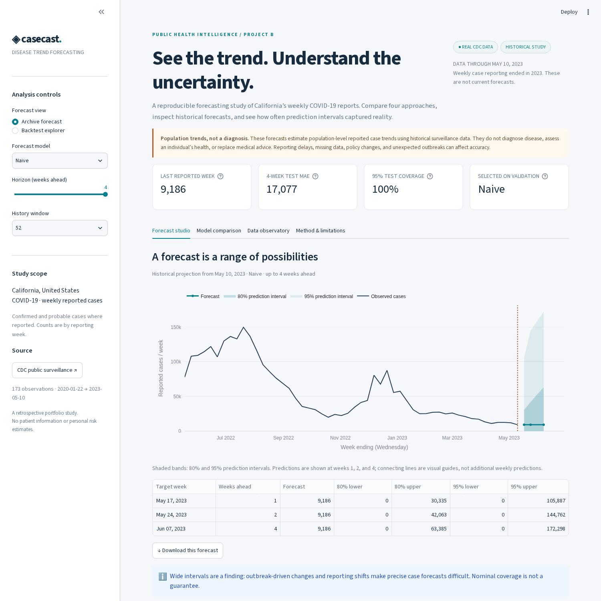
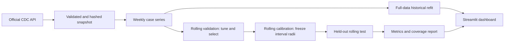

# ◈ Casecast — Disease Trend Forecasting

**Can a machine-learning model outperform a simple forecast when disease reporting changes?**

An end-to-end public health data science project: real CDC surveillance data, four forecasting approaches, chronological evaluation, calibrated prediction intervals, and an interactive Streamlit dashboard.

[](https://github.com/abhinavgautam121/disease-trend-forecasting/actions/workflows/ci.yml)




> **Historical portfolio study, not a current forecast or a clinical tool.** The source ends on May 10, 2023. All forward projections are explicitly dated historical projections.

## The problem

Surveillance teams need to understand possible near-term changes in reported cases without confusing a precise-looking point forecast with certainty. Casecast forecasts California's weekly reported COVID-19 case counts at **1, 2, and 4 weeks ahead**, compares simple and complex approaches on identical targets, and checks whether prediction intervals capture held-out outcomes.

The workflow could inform surveillance research and forecasting-method comparisons. It is not validated for operational allocation decisions and provides no individual health assessment.

## What the results say

**The last-observation naive model was selected on validation and had the lowest test MAE at all three horizons.** Random Forest was implemented and tuned, but complexity did not translate into better generalization in this study.

| Model | 1-week MAE | 2-week MAE | 4-week MAE |
| :--- | ---: | ---: | ---: |
| Last-observation naive | 7,670 | 10,292 | 17,077 |
| Damped ETS | 7,680 | 10,505 | 19,465 |
| Random Forest | 13,961 | 47,043 | 130,140 |
| 52-week seasonal naive | 155,203 | 156,448 | 159,464 |

Errors are in weekly reported cases. Each model/horizon is evaluated at **23 identical test origins**. Rounded results are from the included real-data run; see [complete metrics](reports/test_metrics.csv), [forecast-level outputs](reports/test_predictions.csv), and [results interpretation](reports/results.md).

For the naive model, nominal 95% intervals covered all 23 test outcomes at each horizon. **That is not proof of dependable calibration:** average 95% widths were approximately 133k, 172k, and 199k cases. The calibration period included much larger errors than the later test period. Wide, conservative bands and weak Random Forest long-horizon coverage are meaningful findings, not hidden failures.

## Data provenance

- **Publisher:** U.S. Centers for Disease Control and Prevention.
- **Dataset:** [Weekly United States COVID-19 Cases and Deaths by State — ARCHIVED](https://data.cdc.gov/d/pwn4-m3yp), Socrata ID `pwn4-m3yp`.
- **Scope:** California (`CA`), 173 weekly observations, January 22, 2020–May 10, 2023.
- **Target:** `new_cases`, reported weekly counts; confirmed and probable cases are combined where supplied. This is not positivity, hospitalization, onset-date incidence, or the total number of infections.
- **Reporting period:** Thursday through Wednesday; dates denote week end.
- **Reuse:** source metadata identifies Public Domain U.S. Government. Code is separately MIT licensed.
- **Reproducibility:** exact downloaded response, retrieval timestamp, query URL, source notes, and SHA-256 are committed in [data/raw](data/raw).

The official series ended in 2023, so it cannot supply five years of observations. The project preserves the real archive rather than extending it with invented observations. See the [data card](reports/data_card.md) for reporting and revision limitations.

## Run locally

Use Python 3.12 from the repository root:

```bash
python -m venv .venv
source .venv/bin/activate
# Windows PowerShell: .venv\Scripts\Activate.ps1
python -m pip install -r requirements-lock.txt
python -m pip install --no-deps -e .
streamlit run app/streamlit_app.py
```

The dashboard starts from committed CSV artifacts: **no credentials, training, or external API requests are needed to explore it**.

To reproduce the experiment:

```bash
disease-forecast download    # Fetch the official series and its provenance metadata
disease-forecast run         # Tune, backtest, calibrate, refit, and export reports
# Or: disease-forecast all
bash scripts/run_checks.sh  # Lint, formatting, and tests
```

`configs/default.json` controls splits, horizons, seed, and forest candidates. A full run takes roughly a minute on the development environment; runtime varies by machine. Alternative configurations must leave enough initial training history and at least 19 eligible calibration origins for finite 95% residual quantiles. Source validation stops instead of silently repairing unexpected data.

## Evaluation design



| Stage | Target period | Purpose |
| :--- | :--- | :--- |
| Initial history | Jan 22, 2020–Aug 11, 2021 | 82 observations before validation |
| Validation | Aug 18, 2021–Feb 09, 2022 | 26 weeks; tune two forest configurations and select model |
| Calibration | Feb 16, 2022–Nov 09, 2022 | 39 weeks; estimate interval radii from 36 origins |
| Test | Nov 16, 2022–May 10, 2023 | 26 weeks; report performance at 23 origins |

Every origin uses an expanding prefix of observed history. Only origins whose full set of 1-, 2-, and 4-week targets fits within a stage are retained, preventing target overlap between stages. Thus individual horizons do not cover every date in the 26-week test block. Hyperparameters and model choice are frozen before calibration and testing; later test fits can use earlier observed test weeks, matching sequential weekly forecasting.

**Models:** last-observation naive, 52-week seasonal naive, damped additive-trend exponential smoothing of `log1p(cases)`, and a separate direct Random Forest regressor per horizon. Forest features include observed counts at origin and past lags, trailing means/standard deviations, recent change, and known target-calendar seasonality. A training row is eligible only if its horizon-specific label was already observed.

**Metrics:** MAE, RMSE, and seasonal MASE; MASE's denominator is computed only from each origin's training history. No random splits, MAPE with zero counts, or tuning on final test scores.

**Uncertainty:** for every model and horizon, take absolute errors from the separate rolling calibration period. For coverage `c`, use sorted-error rank `ceil((n+1)*c)`. Forecast ± that frozen radius gives the interval, with lower bounds clipped at zero. Coverage and width are checked on the final test set. Temporal dependence and distribution shifts mean these split-conformal-style intervals have **no asserted coverage guarantee here**. They are prediction intervals, not confidence intervals for parameters, and do not use tree-to-tree variation as uncertainty.

This is a **revised, single-vintage retrospective backtest**, not a reconstruction of the data available in real time. Historical revisions can make retrospective evaluation optimistic.

## Explore the work

- [Exploration notebook](notebooks/01_exploration.ipynb): executed data checks, annual reporting summaries, and model results.
- [Model card](reports/model_card.md): intended use, features, selection, uncertainty, failure modes.
- [Data card](reports/data_card.md): source, definitions, integrity, reuse, and reporting changes.
- [Results report](reports/results.md): actual errors, coverage, widths, and interpretation.
- [Recruiter brief and interview guide](reports/recruiter_brief.md): concise project pitch, honest resume bullets, and a message template.
- [Deployment guide](reports/deployment.md): Streamlit Community Cloud setup.

The interactive HTML figures in `reports/figures` can also be opened locally without running Streamlit; they load Plotly from its public CDN and require an internet connection.

## Quality and engineering

The tests exercise source validation, lag alignment, feature causality, training-label availability, disjoint target periods, baseline alignment, interval nesting, independence from test outcomes, saved-metric consistency, a reduced real-data pipeline, and dashboard control interactions. GitHub Actions runs lint, format checks, and tests from the cached public snapshot without credentials.

The browser smoke check visits all four dashboard tabs, changes models and historical forecast controls, checks for visible exceptions, tests a download, and captures screenshots. Its script is in `scripts/browser_smoke.py`.

Model artifacts are regenerated in ignored `artifacts/`; only small reproducible reports and source data are versioned. The application consumes CSV outputs and does not deserialize user-uploaded model files.

## Limitations and next steps

- Three years of reports, 82 initial training observations, and a small test sample limit conclusions about annual patterns and generalization.
- Changes in testing, home-test reporting, variants, definitions, and reporting backlogs affect reported cases. Outbreak peaks are retained.
- Correlated lag-feature importance is descriptive and not causal. Forests also struggle with unprecedented target values.
- Fixed absolute-error bands can overcover stable periods and under-cover new surges.
- Future work: evaluate historical data vintages; add more geographies and longer comparable disease series; test seasonal statistical models where data support them; compare quantile/scale-adaptive intervals with rolling calibration; include epidemiologically justified external predictors available at each origin.

## Why this is not a diagnosis

The model predicts an aggregate weekly count for a state. It has no symptoms, examination, diagnostic tests, or individual exposure information. A population forecast cannot establish whether a person has a disease. Clinical diagnosis requires individual assessment by qualified professionals.

**Author:** Abhinav Gautam · [GitHub](https://github.com/abhinavgautam121)

